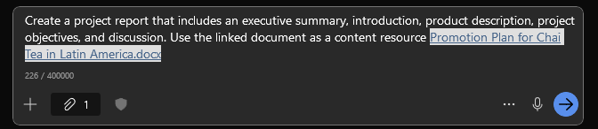

# Microsoft 365 Copilot Prompting: A 20-Minute Hands-On Lab

> A beginner-friendly lab that teaches practical prompting by improving one prompt in four progressively more challenging exercises.

## Lab at a glance

| Item | Details |
|---|---|
| Audience | New Microsoft 365 Copilot users |
| Duration | 20 minutes |
| Format | Individual hands-on lab |
| Experience needed | None |
| Product | Microsoft 365 Copilot Chat |
| Outcome | Write, test, evaluate, and refine a useful work prompt |

## What you will learn

By the end of this lab, you will be able to:

1. Start a prompt with a clear **goal**.
2. Improve the result by adding **context** and **expectations**.
3. Ground a prompt in a specific **source**.
4. Use follow-up prompts to evaluate and refine a response.
5. Review Copilot's output before using or sharing it.

Microsoft describes four useful ingredients for a prompt:

| Ingredient | Question it answers |
|---|---|
| **Goal** | What do you want Copilot to do? |
| **Context** | Why do you need it, and who is it for? |
| **Source** | What information should Copilot use? |
| **Expectations** | What should the response look or sound like? |

You do not need all four ingredients in every prompt. Begin with a clear goal, then add details when they will improve the result.

---

## Before you begin — 2 minutes

1. Open **Microsoft 365 Copilot Chat** using your organization's normal sign-in method.
2. Start a new chat.
3. Keep this lab open in another browser tab.
4. Do not enter confidential, sensitive, or regulated information unless your organization's policies allow it.

> [!NOTE]
> Copilot features and the work information it can access depend on your license and your organization's settings. This lab includes its own fictional source text so everyone can complete the exercises.

### The scenario

You are helping organize **Focus Friday**, a fictional half-day internal event intended to help employees reduce distractions and improve meeting habits.

You will use the same scenario in every exercise. Each round adds another prompting skill.

---

## Exercise 1: Give Copilot a clear goal — 3 minutes

### Your task

Ask Copilot to generate ideas for the event.

### Run this prompt

```text
Give me ideas for a workplace event called Focus Friday.
```

### Review the response

Do not worry about whether the answer is perfect. Look for:

- What assumptions did Copilot make?
- Are the ideas relevant to your workplace?
- Is the response easy to use?
- What important details are missing?

### Make one quick change

Edit the prompt in your own words to make the goal more specific. For example, specify the number or type of ideas you want.

```text
Generate five practical activities for a workplace event called Focus Friday.
```

### Checkpoint

You have completed this exercise when your prompt clearly states the action you want Copilot to take.

**Skill unlocked:** Start with a clear **goal**.

---

## Exercise 2: Add context and expectations — 4 minutes

The first prompt told Copilot what to do, but it did not explain the audience, purpose, tone, or desired format.

### Run this stronger prompt

```text
Generate five practical activities for a workplace event called Focus Friday.

The event is for employees who spend much of their day in meetings and want more uninterrupted time for focused work. The activities should be easy to try during a single half-day event.

Present the answer in a table with these columns:
- Activity
- How it works
- Time required
- Expected benefit

Use a practical, encouraging tone.
```

### Compare the two responses

Ask yourself:

1. Which answer is more relevant to the audience?
2. Which answer would be easier to share with an event organizer?
3. How did the requested table change the response?
4. Did Copilot follow the tone and length implied by the prompt?

### Mini-challenge

Add one constraint that matters to you. Choose one:

- No activity may cost more than $25.
- Every activity must work for remote and in-person employees.
- Each activity must take 30 minutes or less.
- The event must require no special software.

Run the prompt again and inspect what changed.

### Checkpoint

You have completed this exercise when the response reflects a defined audience, purpose, format, tone, and constraint.

**Skills unlocked:** Add **context** and set clear **expectations**.

---

## Exercise 3: Ground the answer in a source — 5 minutes

Copilot can give a more relevant response when you tell it which information to use. In your real work, a source might be a file, email, meeting, chat, or pasted text, depending on your Copilot license and organizational settings.

For this exercise, use the fictional planning notes below.

### Fictional planning notes

```text
FOCUS FRIDAY PLANNING NOTES

Audience: 60 employees across three time zones
Format: Hybrid event
Event window: 9:00 a.m. to 1:00 p.m. Eastern Time
Budget: $1,500 total

Employee feedback:
- Too many meetings without clear agendas
- Frequent chat notifications make focused work difficult
- Remote employees do not want activities that favor people in the office
- Managers want practical habits employees can continue after the event

Required event elements:
- A 15-minute welcome
- One activity about improving meetings
- One activity about managing notifications
- A 30-minute individual focus session
- A closing commitment employees can complete in 10 minutes
```

### Run this grounded prompt

Copy the prompt and the planning notes into Copilot:

```text
Create a proposed agenda for Focus Friday.

The purpose is to help employees reduce distractions and improve meeting habits. Use only the planning notes included below as the source for event requirements. If a necessary detail is missing, label it "To be confirmed" instead of inventing it.

Present the agenda as a table with:
- Start time
- Duration
- Session
- Purpose
- Delivery notes

After the table, list the three most important planning risks. Keep the full response concise enough for an event organizer to review in two minutes.

[Paste the FOCUS FRIDAY PLANNING NOTES here]
```

### Inspect the result

Check whether Copilot:

- Used the event window and required activities.
- Accounted for a hybrid audience across three time zones.
- Avoided inventing unsupported details.
- Produced the requested table and risk list.
- Stayed within the information provided.

### Mini-challenge

Ask Copilot to show where each agenda item came from:

```text
Add a "Source requirement" column to the agenda. For each row, quote or briefly identify the planning-note requirement that supports it. Mark any proposed item that is not directly required as "Suggested addition."
```

### Checkpoint

You have completed this exercise when you can distinguish between information supported by the supplied source and suggestions added by Copilot.

**Skill unlocked:** Ground a prompt in a specific **source**.

---

## Exercise 4: Refine the result through conversation — 5 minutes

A strong prompting workflow is usually a conversation, not one perfect prompt. Keep working in the same chat so Copilot can use the result you just created.

### Step 1: Ask Copilot to critique its work

```text
Review the agenda against every requirement in the planning notes.

Create a checklist showing:
- Requirement
- Covered, partially covered, or missing
- Where it appears in the agenda
- Recommended correction

Do not rewrite the agenda yet.
```

### Step 2: Correct the weak spots

Review the checklist. Then run:

```text
Revise the agenda to fix every item marked partially covered or missing.

Keep the original table structure. After the revised agenda, add a short section called "What changed" that identifies the corrections you made.
```

### Step 3: Adapt the output for a different audience

Choose **one** final challenge.

#### Option A — Executive summary

```text
Turn the revised agenda into an executive summary for a department leader.

Keep it under 150 words. Emphasize the business purpose, employee benefit, major risk, and decision needed. Use a confident, concise tone.
```

#### Option B — Employee announcement

```text
Turn the revised agenda into an employee announcement.

Keep it under 200 words. Explain why employees should participate, what they will experience, and what they should do next. Use a friendly, energetic tone.
```

#### Option C — Facilitator checklist

```text
Turn the revised agenda into a facilitator checklist.

Organize it into:
- Before the event
- During the event
- After the event

Use action verbs, include the responsible role when it is known, and mark unknown owners as "Owner needed."
```

### Checkpoint

You have completed this exercise when you have used follow-up prompts to critique, correct, and adapt an existing response instead of starting over.

**Skills unlocked:** **Iterate**, **evaluate**, and **transform** Copilot's output.

---

## Wrap-up — 1 minute

You progressed from a simple request to a structured, grounded, and reusable prompting workflow:

```text
GOAL
What should Copilot do?

+ CONTEXT
Why is it needed, and who is it for?

+ SOURCE
What information should Copilot use?

+ EXPECTATIONS
What should the result look and sound like?

+ FOLLOW-UP
What should Copilot check, correct, or transform next?
```

Before using Copilot-generated content, always review it for:

- **Accuracy:** Are the facts and calculations correct?
- **Completeness:** Did it address every requirement?
- **Grounding:** Can you distinguish supported information from suggestions?
- **Audience:** Is the language appropriate for the reader?
- **Format:** Did Copilot follow your requested structure and constraints?
- **Safety:** Is the content appropriate to share under your organization's policies?

## Your reusable prompt template

```text
[GOAL: State the action and desired outcome.]

[CONTEXT: Explain the purpose, audience, and relevant situation.]

[SOURCE: Identify or provide the information Copilot should use.]

[EXPECTATIONS: Specify the format, tone, length, constraints, and quality criteria.]

If required information is missing, [explain how Copilot should handle the gap].
```


# Draft, improve, and share your document with Copilot in Word

Imagine you're a project manager tasked with creating a comprehensive project report for your company's new Mystic Spice Premium Chai Tea. In this Lab, you use Microsoft Word to draft the report, (optionally) import notes from OneNote, and share the draft with your team via Microsoft Teams or Microsoft Outlook for feedback and collaboration.

> [!NOTE]
> While this Lab illustrates how information can flow from one Microsoft 365 app to another, you aren't required to do so. Each of these steps can be completed using Copilot in Word directly. Alternate steps are provided as necessary.

## Sample file

Throughout this Lab, we'll craft prompts for Microsoft 365 Copilot that reference this file. You should have already uploaded it to OneDrive during the lab setup process, but if you need to download it again, you can do so here:

[Market Analysis Report for Mystic Spice Premium Chai Tea.docx](https://go.microsoft.com/fwlink/?linkid=2268826)


### Exercise 1 - Draft your content

Let's create a project report using the Market Analysis you've already gathered. Then, we can edit this file to get the content we need for our report.

1. Open a new Word document in the desktop app, not the web app. (Start / Word / Choose **Blank Document**)

2. Open Copilot Chat within Word and enter the following prompt:

```
Create a project report that includes an executive summary, introduction, product description, project objectives, and discussion.
Use the linked document as a content resource
```
   
4. Add the document reference to your prompt by manually entering a forward slash followed by the document name: **/Promotion Plan for Chai Tea in Latin America.docx**. If the document does not appear from your MRU or Most Recently Used list, you can select **Reference a file** and the file from the dropdown list once it is available in OneDrive.

 
   
5. Click on the *Send* button, wait for Copilot to render, click *Done*, and then review the drafted content.

> [!Note]
> You can fine tune the draft created by adding some detail and regenerating.  In the Copilot Chat pane, you can:
> 
> *Make it sound like Snoop Dogg*
> 
> *Make it sound like a tv newscaster*
> 
> *Make it shorter and casual*
>
> If you examine any of these changes, click *Undo* to discard your recently generated content.

6.  As you're reviewing the content of your document, you may find that some text needs to be edited or rewritten. The Product Description section seems to be fairly short, and technical. Let's edit the text so it's more engaging for our readers.

8. Highlight the paragraph, select the **Edit Copilot** icon that appears to the left of the text.

9. Click on the message box and select **Auto Rewrite** from the menu. Copilot generates new content.  Select **Undo** to discard the changes.

10. Let's enter a specific prompt to get the results we want. While keeping the same Product Description text highlighted, enter the following into the Chat pane:

```
Rewrite this paragraph to add more detail about the product.
The tone of this paragraph should be professional and engaging.
```

11. Review the changes, then click **Done**.

### Exercise 2 - Convert text to a table

While the content in your document may be accurate, consider its readability. Would a section work better if it was presented as a table? Copilot can easily convert text into a table using a prompt.

Let's see this transformation in action.

1. In the Copilot pane run the following prompt:
 ```
   Add a list of project milestones and their deadlines
   ```
    

2. Select **Done** to add the section to your document.

3. Highlight the list the Copilot just created and select  **Edit with Copilot**.

4. Enter the following text and once Copilot renders, click **Done**.
```
Visualize as a table
```
The result looks great, overall, but let's make sure there's a column for when the task is successfully completed.

5. Type
```
   Add a third column, Task Completed, to the table
   ```
   
6. Select **Done** to insert the table into your document.

7. Review the table format and make any necessary adjustments.  You may want to ask Copilot to add color banding to the table, and don't forget to tell Copilot what your favorite colors are.  Click **Done** when complete.  

```
Add cobalt blue to the header row and pink banding to every other row 
```

8. Lastly, Revise the table to center the text:
```
center the text in the table
```

### Exercise 3 - Summarize your document

As you complete your document, you want to ensure that your key points are presented clearly. A good way to do this is to see a summary of the document. Likewise, should you receive a large Word document that you don't have time to read in its entirety, the summary feature is key. Let's create a summary at the end of our document.

1. Open the Copilot pane and enter the following prompt:

```
Summarize this document. Highlight the top three points made 
```

1. Review the generated summary, and then experiment with any options Copilot may suggest by taking the Action Items from Copilot and turning them into prompts.

### Exercise 4 - How Readable is the document?

Ok, great, Copilot generated all the content. Neat stuff.  How do I make sure it's readable for my target audience?  Ask Copilot!

```
review this document and provide suggestions and improvements if executives are the target audience.
```

Review the suggestions and apply any changes that you'd like.

### Exercise 5 - Refine the result through conversation — 5 minutes

A strong prompting workflow is usually a conversation, not one perfect prompt. Keep working in the same chat so Copilot can use the result you just created.

### Step 1: Ask Copilot to critique its work

```text
Review the agenda against every requirement in the planning notes.

Create a checklist showing:
- Requirement
- Covered, partially covered, or missing
- Where it appears in the agenda
- Recommended correction

Do not rewrite the agenda yet.
```

### Step 2: Correct the weak spots

Review the checklist. Then run:

```text
Revise the agenda to fix every item marked partially covered or missing.

Keep the original table structure. After the revised agenda, add a short section called "What changed" that identifies the corrections you made.
```

### Step 3: Adapt the output for a different audience

Choose **one** final challenge.

#### Option A — Executive summary

```text
Turn the revised agenda into an executive summary for a department leader.

Keep it under 150 words. Emphasize the business purpose, employee benefit, major risk, and decision needed. Use a confident, concise tone.
```

#### Option B — Employee announcement

```text
Turn the revised agenda into an employee announcement.

Keep it under 200 words. Explain why employees should participate, what they will experience, and what they should do next. Use a friendly, energetic tone.
```

#### Option C — Facilitator checklist

```text
Turn the revised agenda into a facilitator checklist.

Organize it into:
- Before the event
- During the event
- After the event

Use action verbs, include the responsible role when it is known, and mark unknown owners as "Owner needed."
```

## End of Lab  ##
