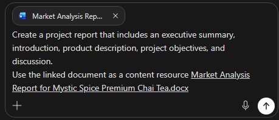

# Draft, improve, and share your document with Copilot in Word

## Sample file

Throughout this Lab, we'll craft prompts for Microsoft 365 Copilot that reference this file. Please download the following file:

[Market Analysis Report for Mystic Spice Premium Chai Tea.docx](https://go.microsoft.com/fwlink/?linkid=2268826)

## Before you begin — 3 minutes
> [!IMPORTANT]
> Please complete these steps only if you have not recently updated your version of Office.
- Open Microsoft Word and create a blank document.
- Click on **File** then **Account**. In the middle of your screen, click on **Update Options**, then **Update Now**.

### Exercise 1 - Draft your content

Let's create a project report using the Market Analysis you've already gathered. Then, we can edit this file to get the content we need for our report.

1. Open a new Word document in the desktop app, not the web app. (Start / Word / Choose **Blank Document**)

2. Open Copilot Chat within Word and enter the following prompt:

```
Create a project report that includes an executive summary, introduction, product description, project objectives, and discussion.
Use the linked document as a content resource
```
   
4. Add the document reference to your prompt by manually entering a forward slash followed by the document name: **/Market Analysis Report for Mystic Spice Premium Chai Tea**. If the document does not appear from your MRU or Most Recently Used list, you can select **Reference a file** and the file from the dropdown list once it is available in OneDrive.

 
   
5. Click on the *Send* button, wait for Copilot to render, and then click **Done**.  Review the drafted content.

> [!Note]
> You can fine tune the draft created by adding some detail and regenerating.  In the Copilot Chat pane, you can:
> 
```
Make it sound like Snoop Dogg
```

```
Make it sound like a tv newscaster
```
 
```
Make it shorter and casual
```

> If you make any of these changes, click **Undo** to discard your recently generated content.

6.  As you're reviewing the content of your document, you may find that some text needs to be edited or rewritten. The Product Description section seems to be fairly short, and technical. Let's edit the text so it's more engaging for our readers.

8. Highlight the Product Description section, select the **Edit with Copilot** icon that appears to the left of the text.

9. Click on the message box and select **Auto Rewrite** from the menu. Copilot generates new content.  Take a moment to review the changes and then select **Undo** to discard the changes.

10. Let's enter a specific prompt to get the results we want. While keeping the same Product Description text highlighted, enter the following into the Chat pane:

```
Rewrite this paragraph to add more detail about the product.
The tone of this paragraph should be professional and engaging.
```

11. Review the changes, then click **Done**.

### Exercise 2 - Convert text to a table

While the content in your document may be accurate, consider its readability. Would a section work better if it was presented as a table? Copilot can easily convert text into a table using a prompt.

Let's see this transformation in action.

1. In the Copilot pane run the following prompt:
 ```
   Add a list of project milestones and their deadlines
   ```
    

2. Select **Done** to add the section to your document.

3. Highlight the list the Copilot just created and select  **Edit with Copilot**.

4. Enter the following text and once Copilot renders, click **Done**.
```
Visualize as a table
```

5. The result looks great, overall, but let's make sure there's a column for when the task is successfully completed. Enter:
```
   Add a third column, Task Completed, to the table
   ```
   
6. Select **Done** to update the table in your document.

7. Review the table format and make any necessary adjustments.  You may want to ask Copilot to add color banding to the table, and don't forget to tell Copilot what your favorite colors are.  Click **Done** when complete.  

```
Add cobalt blue to the header row and pink banding to every other row 
```

8. Lastly, Revise the table to center the text:
```
center the text in the table
```

### Exercise 3 - Summarize your document

As you complete your document, you want to ensure that your key points are presented clearly. A good way to do this is to see a summary of the document. Likewise, should you receive a large Word document that you don't have time to read in its entirety, the summary feature is key. Let's create a summary at the end of our document.

1. Open the Copilot pane and enter the following prompt:

```
Summarize this document. Highlight the top three points made 
```

1. Review the generated summary, and then experiment with any options Copilot may suggest by taking the Action Items from Copilot and turning them into prompts.

### Exercise 4 - How Readable is the document?

Ok, great, Copilot generated all the content. Neat stuff.  How do I make sure it's readable for my target audience?  Ask Copilot!

```
review this document and provide suggestions and improvements if executives are the target audience.
```

Review the suggestions and apply any changes that you'd like.

### Exercise 5 - Refine the result through conversation — 5 minutes

A strong prompting workflow is usually a conversation, not one perfect prompt. Keep working in the same chat so Copilot can use the result you just created.

### Step 1: Ask Copilot to critique its work

```text
Review the agenda against every requirement in the planning notes.

Create a checklist showing:
- Requirement
- Covered, partially covered, or missing
- Where it appears in the agenda
- Recommended correction

Do not rewrite the agenda yet.
```

### Step 2: Correct the weak spots

Review the checklist. Then run:

```text
Revise the agenda to fix every item marked partially covered or missing.

Keep the original table structure. After the revised agenda, add a short section called "What changed" that identifies the corrections you made.
```

### Step 3: Adapt the output for a different audience

Choose **one** final challenge.

#### Option A — Executive summary

```text
Turn the revised agenda into an executive summary for a department leader.

Keep it under 150 words. Emphasize the business purpose, employee benefit, major risk, and decision needed. Use a confident, concise tone.
```

#### Option B — Employee announcement

```text
Turn the revised agenda into an employee announcement.

Keep it under 200 words. Explain why employees should participate, what they will experience, and what they should do next. Use a friendly, energetic tone.
```

#### Option C — Facilitator checklist

```text
Turn the revised agenda into a facilitator checklist.

Organize it into:
- Before the event
- During the event
- After the event

Use action verbs, include the responsible role when it is known, and mark unknown owners as "Owner needed."
```

## End of Lab  ##
