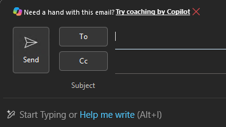

# Improve your email workflows with Outlook #

> [!NOTE]
> Due to difference in the Copilot User Interface, you may see slight variations between the instructions below and what you see on your desktop.


## Exercises
Please complete the following exercises as part of this lab:

#### Exercise 1 - Draft an email with Copilot in Outlook
#### Exercise 2 - Get coaching on your email
#### Exercise 3 - How can AI help me be productive?
#### Exercise 4 - Triage your inbox with Copilot in Outlook


## Exercise 1 - Draft an email with Copilot in Outlook ###
1. Open Microsoft Outlook on the desktop and select **New Email**.
1. Click on **Help me write** (Alt + I), then enter the following prompt:
   
 


```
Write an email to my manager about taking some vacation time
```


3. Once Copilot creates the email, click on Pen/Copilot icon and choose an option that sounds interesting.
5. Review the email, noticing the changes. When ready, click on **Replace**.  
6. Click on Pen/Copilot icon once again and choose a different option, trying different combinations.

## Exercise 2 - Get coaching on your emails ###
Everybody is moving fast these days and we tend to write terse messages that lack emotion and emphathy.  Copilot Coaching can help with that.

1. Open Microsoft Outlook on the desktop and select **New Email**.
2. Paste in the following text:

```
Please let me know the status of the finance report.  Time is of the essence and we're waiting for your response.
```

> [!NOTE]
> You are required to type in at least 100 characters into your email in order for Copilot to provide any coaching.
>
3. Toward the top of the screen, click on **Try coaching by Copilot**.
4. Copilot responds with suggestions in the following catagories.  
   * Tone
   * Reader Sentiment
   * Clarity
  
5. Take a moment to review the feedback Copilot provided you and then click on **Apply all suggestions**. Once complete, click on **Keep it**, noticing how your email changes.
6. Click on the Copilot icon and choose any option to modify your text.


## Exercise 3 - How can AI help me be productive?
Copilot can help you improve your overall productivity.  Try these examples:

1. Open Microsoft Outlook on the desktop, then a new Copilot Chat Window, and enter these prompts, taking time to examine the results:
   
```
Analyze my writing style and make suggestions on how to improve it
```

```
Review my week like it’s a case study: What’s working? What’s not? Use Markdown to create a structured and visually appealing analysis.
Include sections for successes, challenges, and recommendations. Highlight key points with bullet points, bold text, and italicized highlights to enhance readability and impact.
Include any relevant data or metrics to support the analysis and provide actionable insights for improvement.
```

  ## Exercise 4 - Triage your inbox with Copilot in Outlook
Start by identifying which messages actually need your attention.

1. Open Outlook and select the Copilot icon.
2. Enter the prompt:
```
Show me emails where I'm on the To line that I haven't replied to.
```
3. Review the results. Identify one thread that requires a substantive response.
4. ask a follow-up question such as:
```
Do I have any meetings today that relate to this thread? to check for calendar context before you respond.
```
5. *CHALLENGE: How would you make this a scheduled prompt?*

## End of Lab ##
